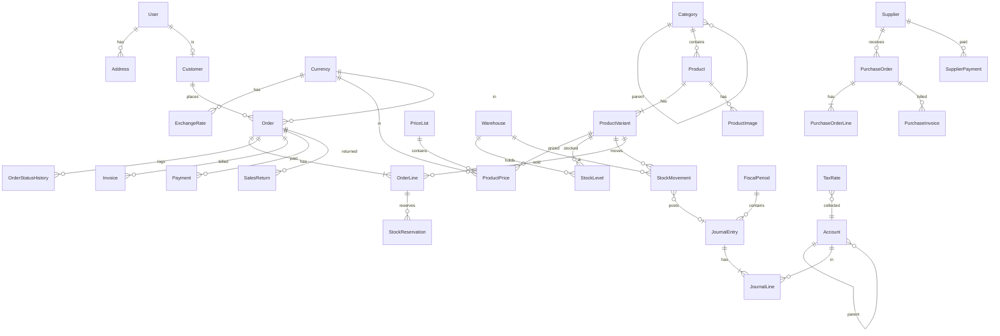

# تصميم قاعدة البيانات (PostgreSQL)

## مبادئ عامة
- PK: `BigAutoField`، ومعه `uuid` (فريد) يُستخدم في الـ API العام.
- كل جدول: `created_at`, `updated_at`، والجداول التشغيلية: `created_by`.
- المبالغ: `NUMERIC(18,4)`، الكميات: `NUMERIC(14,3)`، أسعار الصرف: `NUMERIC(18,8)`.
- المستندات المالية لا تُحذف: `status` + إلغاء بقيد عكسي. بقية الكيانات: soft delete (`deleted_at`).
- `StockMovement` و`JournalLine` و`JournalEntry` المرحّل: **append-only**.
- لقطات (snapshots) في الطلبية: اسم/SKU/سعر/تكلفة/عنوان، كي لا يتغير التاريخ بتغير الكتالوج.
- التصميم جاهز لإضافة `company_id` لاحقاً (لا ارتباطات تفترض شركة واحدة في الـ constraints سوى الفرادة).

## ERD

## core
**DocumentSequence**: `key` (مثل `ORDER-2026`), `prefix`, `next_value`, `padding` — فريد على `key`، يُقفل بـ `select_for_update`.
**AuditLog**: `actor`, `action`, `model`, `object_id`, `before JSONB`, `after JSONB`, `at`.

## accounts
**User**: `phone` (فريد، إلزامي؛ أرقام فقط بصيغة دولية مثل 970591234567؛ هو هوية الحساب المُتحقَّق منها بواتساب)، `full_name`, `user_type` (customer/staff), `is_superadmin` (أدمن: يتجاوز فحص الصلاحيات)، `is_active`, `last_login`. **لا يوجد بريد ولا كلمة مرور** (كلمة المرور الداخلية unusable دائماً). قيد: `is_superadmin` يتطلب `user_type='staff'`.
**WhatsAppCode**: `phone`, `code_hash` (HMAC لا الرمز نفسه), `expires_at`, `attempts`, `consumed_at`, `requested_ip`.
**Address**: `user`, `label`, `recipient`, `phone`, `country`, `city`, `line1`, `line2`, `postal_code`, `is_default`.

### نظام الصلاحيات (RBAC ديناميكي)
**Permission**: كتالوج رموز الصلاحيات (يُزرع من الكود عبر migration/`sync_permissions`، لا يُنشئه المستخدم): `code` فريد بصيغة `module.action`، `module`, `description`.
**Role**: `name` فريد, `description`, `is_system` (قالب جاهز لا يُحذف لكن يُعدَّل), `created_by`.
**RolePermission**: `role`, `permission` — فريد `(role, permission)`.
**UserRole**: `user`, `role`, `assigned_by`, `assigned_at` — فريد `(user, role)`؛ مسموح لموظف أكثر من دور.
**UserPermissionOverride**: `user`, `permission`, `effect` (allow/deny), `scope JSONB` (اختياري), `granted_by`, `expires_at` (اختياري، صلاحية مؤقتة), `reason`.
**نطاق (Scope) اختياري** على `RolePermission` و`UserPermissionOverride`، مثل `{"warehouses": [3,5]}` أو `{"max_discount_pct": 10}` أو `{"max_amount": "500.0000"}`.

**حساب الصلاحية الفعلية:** `user.is_superadmin` ⇒ مسموح. وإلا: وجود `deny` مباشر ⇒ مرفوض؛ ثم `allow` مباشر أو صلاحية من أي دور ⇒ مسموح (مع دمج النطاقات: الأضيق يطبّق إذا تعارضت لدور واحد، والأوسع لمن يملك أكثر من دور). الناتج يُخزَّن مؤقتاً في الكاش لكل مستخدم ويُبطل عند أي تغيير في أدواره/صلاحياته.

### كتالوج الصلاحيات (`module.action`)
| الوحدة | الصلاحيات |
|---|---|
| `products` | `view`, `create`, `update`, `delete`, `publish`, `toggle_visibility`, `archive`, `import`, `export`, `manage_prices` |
| `categories` | `view`, `manage` |
| `inventory` | `view`, `adjust`, `transfer`, `stocktake`, `view_cost`, `manage_warehouses` |
| `orders` | `view`, `create`, `update`, `confirm`, `process`, `ship`, `deliver`, `cancel`, `return`, `apply_discount` |
| `payments` | `view`, `record`, `refund` |
| `customers` | `view`, `create`, `update`, `delete`, `view_balance` |
| `purchasing` | `view`, `create`, `approve`, `receive`, `pay_supplier`, `manage_suppliers` |
| `accounting` | `view`, `create_entry`, `post_entry`, `reverse_entry`, `manage_accounts`, `close_period`, `manage_tax`, `manage_currencies` |
| `reports` | `sales`, `inventory`, `financial`, `export` |
| `users` | `view`, `create`, `update`, `deactivate`, `manage_roles`, `manage_permissions` *(للأدمن فقط افتراضياً)* |
| `settings` | `view`, `manage`, `view_audit_log` |
> صلاحيات `users.*` و`settings.manage` و`accounting.close_period` لا تُمنح إلا بتأكيد صريح، وكل منحها/سحبها يُسجَّل في AuditLog.

### القوالب الجاهزة (تُزرع كبداية قابلة للتعديل)
- **محاسب:** `accounting.*`, `reports.*`, `*.view` للمبيعات/المشتريات/المخزون.
- **أمين مخزن:** `inventory.*` (دون `view_cost`), `products.view`, `orders.view/process/ship`, `purchasing.receive`.
- **مبيعات:** `orders.*` (دون `cancel` بعد الشحن), `customers.*`, `payments.record`, `products.view`.
- **مدير متجر:** `products.*`, `categories.*`, `orders.view`.

## currencies
**Currency**: `code` PK-ish فريد (ISO 4217), `name`, `symbol`, `decimals`, `is_base` (قيد: عملة أساسية واحدة فقط — partial unique index), `is_active`.
**ExchangeRate**: `currency`, `date`, `rate_to_base` — فريد `(currency, date)`. العملة الأساسية = 1 دائماً.

## catalog
**Category**: `parent` (self), `name`, `slug` فريد, `sort_order`, `is_active`.
**Product**: `name`, `slug` فريد, `description`, `category`, `brand`, `status` (draft/active/archived), **`is_visible_on_store`** (bool), `track_inventory`, `tax_rate` (FK اختياري), `deleted_at`.
> الظهور للزبون = `status='active' AND is_visible_on_store AND deleted_at IS NULL` ووجود variant فعّال واحد على الأقل. فهرس جزئي على هذا الشرط.

**ProductVariant**: `product`, `sku` (فريد), `barcode`, `name`, `attributes JSONB`, `cost_price` (متوسط مرجّح بالعملة الأساسية), `weight`, `reorder_level`, `is_active`, `deleted_at`.
**ProductImage**: `product`, `variant` (اختياري), `image`, `alt`, `sort_order`, `is_primary`.
**PriceList**: `name`, `currency`, `is_default`, `is_active`.
**ProductPrice**: `variant`, `price_list`, `price`, `compare_at_price`, `valid_from`, `valid_to` — فريد `(variant, price_list)` للسعر الحالي. سعر لكل عملة عبر قائمة أسعار لكل عملة.

## inventory
**Warehouse**: `code` فريد, `name`, `address`, `is_default`, `is_active`.
**StockLevel**: `variant`, `warehouse`, `on_hand`, `reserved` — فريد `(variant, warehouse)`؛ CHECK: `on_hand >= 0`, `reserved >= 0`, `reserved <= on_hand`. (`available` محسوبة.)
**StockMovement** *(append-only)*: `variant`, `warehouse`, `type` (purchase_in, sale_out, return_in, return_out, adjustment, transfer_in, transfer_out, opening), `quantity` (موجب=دخول، سالب=خروج), `unit_cost`, `balance_after`, `ref_type`/`ref_id` (generic: order, PO, adjustment…), `journal_entry` (اختياري), `note`, `created_by`, `created_at`. فهارس: `(variant, warehouse, created_at)`, `(ref_type, ref_id)`.
**StockReservation**: `order_line`, `variant`, `warehouse`, `quantity`, `status` (active/fulfilled/released/expired), `expires_at`.
**StockAdjustment** + **Line**: `number`, `warehouse`, `reason` (count/damage/loss/found/other), `status` (draft/posted), lines: `variant`, `system_qty`, `counted_qty`, `diff`.
**StockTransfer** + **Line**: `number`, `from_warehouse`, `to_warehouse`, `status` (draft/in_transit/received/cancelled).

## sales
**Customer**: `user` (nullable — زبون بدون حساب), `code`, `name`, `email`, `phone`, `default_currency`, `receivable_account`, `credit_limit`, `is_active`.
**Cart / CartItem**: `customer` أو `session_key`, `currency`, items: `variant`, `quantity`.
**Order**: `number` فريد, `customer`, `channel` (web/manual/pos), `status`, `payment_status` (unpaid/partial/paid/refunded), `fulfillment_status`, `currency`, `exchange_rate`, `subtotal`, `discount_total`, `tax_total`, `shipping_total`, `total`, `amount_paid`, `shipping_address JSONB`, `billing_address JSONB`, `note`, `idempotency_key` (فريد), `placed_at`, `confirmed_at`, `shipped_at`, `delivered_at`, `cancelled_at`.
**OrderLine**: `order`, `variant`, `sku`, `name` (snapshot), `quantity`, `unit_price`, `discount`, `tax_rate`, `tax_amount`, `line_total`, `unit_cost` (snapshot للربحية), `warehouse`.
**OrderStatusHistory**: `order`, `from_status`, `to_status`, `changed_by`, `note`, `at`.
**Invoice** + **InvoiceLine**: `number`, `order`, `customer`, `date`, `due_date`, `currency`, `rate`, `subtotal`, `tax`, `total`, `status` (draft/issued/paid/void), `journal_entry`.
**Payment**: `number`, `order`/`invoice`, `customer`, `method` (cash/card/bank/cod/online), `amount`, `currency`, `exchange_rate`, `amount_base`, `deposit_account`, `status` (pending/completed/failed/refunded), `reference`, `journal_entry`.
**SalesReturn** + **Lines**: `order`, `reason`, `status`, `restock` (bool), `refund_amount`, `journal_entry`.

## purchasing
**Supplier**: `code`, `name`, `email`, `phone`, `currency`, `payable_account`, `is_active`.
**PurchaseOrder** + **Line**: `number`, `supplier`, `warehouse`, `currency`, `exchange_rate`, `status` (draft/ordered/partial/received/cancelled), lines: `variant`, `qty_ordered`, `qty_received`, `unit_cost`, `tax_rate`.
**PurchaseReceipt** (استلام) + lines → ينتج `purchase_in`.
**PurchaseInvoice**: `number`, `supplier`, `purchase_order`, `total`, `status`, `journal_entry`.
**SupplierPayment**: `supplier`, `amount`, `currency`, `rate`, `paid_from_account`, `journal_entry`.

## accounting
**Account**: `code` فريد, `name_ar` و`name_en` و`name_he` (ثلاث لغات)، `type` (asset/liability/equity/revenue/expense), `parent`, `is_postable` (الأوراق فقط), `currency` (nullable = أي عملة), `is_system` (حسابات النظام الافتراضية), `is_active`.
**FiscalPeriod**: `name`, `start_date`, `end_date`, `status` (open/closed) — قيد عدم تداخل (exclusion constraint على الفترات).
**JournalEntry**: `number`, `date`, `period`, `memo`, `status` (draft/posted/reversed), `source_type`/`source_id`, `reversal_of`, `posted_at`, `posted_by`.
**JournalLine**: `entry`, `account`, `description`, **بالعملة الأصلية:** `currency`, `amount_currency`, `rate`، **بالأساسية:** `debit`, `credit` (CHECK: أحدهما صفر والآخر ≥ 0 وليسا صفرين معاً)، `party_type`/`party_id` (عميل/مورد للذمم).
- ثابت (invariant): لكل قيد مرحّل `SUM(debit) = SUM(credit)` — يُفرض في `post_entry` ومحمي بـ constraint trigger على PostgreSQL.
**TaxRate**: `name`, `rate`, `collected_account`, `paid_account`, `is_active`.

## الحسابات الافتراضية (Seed)
1xxx أصول: الصندوق، البنك، ذمم العملاء، المخزون، ضريبة مدفوعة.
2xxx التزامات: ذمم الموردين، ضريبة مستحقة.
3xxx حقوق ملكية: رأس المال، أرباح محتجزة.
4xxx إيرادات: المبيعات، مرتجعات المبيعات، أرباح فروقات صرف.
5xxx مصروفات: تكلفة المبيعات، فروقات جرد، خسائر فروقات صرف، مصروفات الشحن.

## الفهارس (Indexes)

**المبدأ:** نفهرس ما تحتاجه الاستعلامات الفعلية فقط. كل فهرس يسرّع القراءة لكنه يبطّئ الكتابة ويستهلك مساحة، فلا نفهرس كل عمود. والفهارس التي ينشئها Django تلقائياً (المفتاح الأساسي، `unique`، وكل `ForeignKey`) تغطي معظم البحث بالمعرّفات والربط.

### مغطّاة تلقائياً
`User.phone` · `Permission.code` · `Role.name` · `Product.slug` · `ProductVariant.sku` · `Category.slug` · `Warehouse.code` · `StockAdjustment.number` · `StockTransfer.number` · كل `uuid` · كل `ForeignKey` · القيود الفريدة المركّبة: `(variant, warehouse)` للرصيد، `(variant, price_list)` للسعر، `(currency, date)` لسعر الصرف، `(user, role)`، `(user, permission)`.

### فهارس أُضيفت يدوياً (وسبب كل منها)
| الجدول | الفهرس | الاستعلام الذي يخدمه |
|---|---|---|
| `Product` | `-created_at` جزئي: فعّال + ظاهر + غير محذوف | قائمة المتجر العامة (الأحدث أولاً)؛ الفهرس صغير لأنه لا يحوي المخفي ولا المسودات |
| `Product` | `-created_at` جزئي: غير محذوف | قائمة الإدارة |
| `Product` | `status` | تصفية الحالة |
| `StockMovement` | `(variant, warehouse, created_at)` | سجل صنف في مخزن |
| `StockMovement` | `(variant, created_at)` | تاريخ صنف عبر كل المخازن (الأكثر استعمالاً) |
| `StockMovement` | `(warehouse, created_at)` | حركات مخزن |
| `StockMovement` | `(type, created_at)` | تصفية بنوع الحركة (مبيعات، تحويل…) |
| `StockMovement` | `(ref_type, ref_id)` | حركات طلب أو مستند معيّن |
| `StockMovement` | `created_at` | الترتيب العام |
| `StockReservation` | `expires_at` جزئي: الحجوزات النشطة فقط | مهمة تحرير الحجوزات المنتهية؛ لا تفحص المنفَّذ والمحرَّر |
| `StockReservation` | `(ref_type, ref_id)` | حجوزات طلب معيّن |
| `StockAdjustment` | `(status, -created_at)` | قوائم المسودات/المرحّلة |
| `StockTransfer` | `(status, -created_at)` | قوائم التحويلات قيد الشحن/المستلمة |
| `User` | `(user_type, -created_at)` | قائمتا الموظفين والزبائن |
| `AuditLog` | `(object_type, object_id)` | تاريخ سجل واحد |
| `AuditLog` | `(actor, -at)` | ما فعله مستخدم |
| `AuditLog` | `action` و`at` | تصفية الحدث والفترة |
| `WhatsAppCode` | `(phone, -created_at)` | آخر رمز لرقم |

تحقّقنا بتحليل خطة الاستعلام (`EXPLAIN`) على بيانات بحجم عشرات الآلاف أن هذه الاستعلامات تستعمل الفهارس.

### مقصود عدم فهرسته
- جداول صغيرة (`Currency`, `Warehouse`, `Role`, `Permission`, `Category`, `PriceList`): المسح الكامل أسرع من الفهرس.
- أعمدة منطقية مثل `is_active` وحدها: انتقائيتها ضعيفة. تُفهرس فقط ضمن فهرس جزئي كما في المنتجات.
- بحث النص `icontains` في أسماء المنتجات: لا يستفيد من فهرس عادي. عند كبر الكتالوج على PostgreSQL نضيف فهرس `pg_trgm` (GIN) أو بحثاً نصياً كاملاً، وهو خاص بـ PostgreSQL فلم يُضف الآن.

### للمراحل القادمة (مخطط لها)
`Order(customer, placed_at)` · `Order(status)` · `JournalLine(account, entry)` · `JournalEntry(date)` · `JournalLine(party_type, party_id)`. تُضاف مع بناء الجداول.
